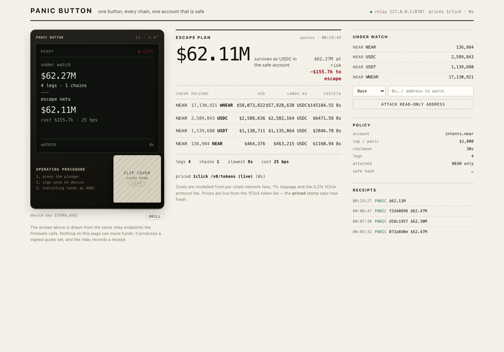
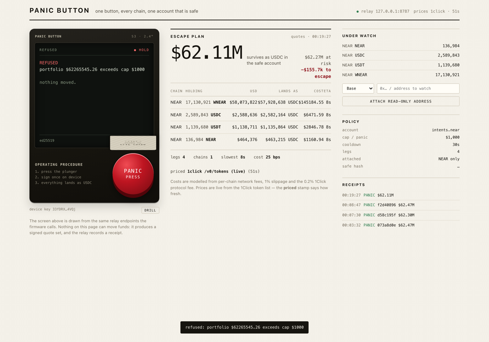
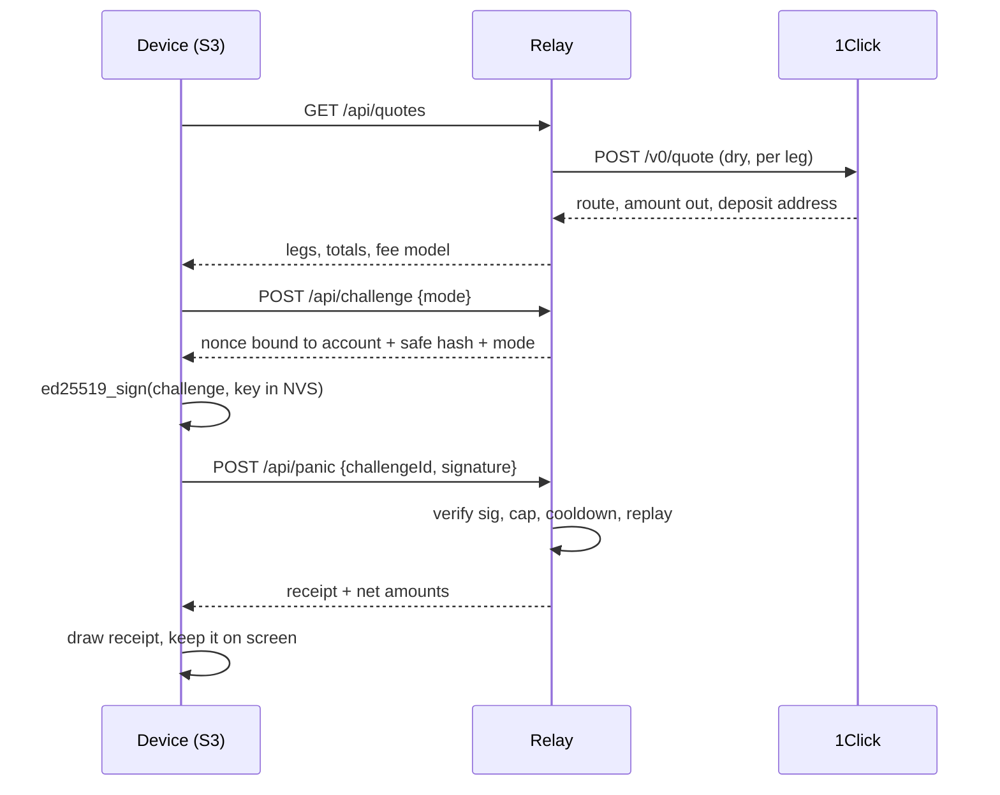

# Panic Button

**One physical button that gets your money out of every chain at once, through NEAR Intents.**



A red plunger under a flip cover. Lift the cover, press, and one signature sweeps the attached
portfolio into USDC and sends it to a safe account you named in advance. The screen shows the route,
the slippage, the net, and one deadpan line. No wallet popup, no chain picker, no seed phrase on a
laptop in a hotel room.

Chain abstraction is usually a dropdown. This is the version you can hit.

---

## The demo, in order

| | |
| --- | --- |
|  |  |
| **REFUSED**: the portfolio is $62.3M, the per-panic cap is $1,000. The server answers 402, the device draws the refusal, nothing moves. | **ESCAPED**: cap raised, cover up, press. Four legs, 25 bps of cost, a 64-hex receipt, and the amounts that actually landed. |

The refusal is the product. A kill switch you cannot bound is a liability, so the cap and the
destination are set before the emergency, not during it.

[`docs/demo.mp4`](docs/demo.mp4) is the 18 second capture: refused at a $1,000 cap, then the same
press escaping once the cap is raised.

---

## Run it

```bash
git clone <this repo> panic-button && cd panic-button
npm install
npm run verify
```

Expected, and this is the whole shape of the thing:

```
Panic Button verification · relay http://127.0.0.1:8899 (spawned)
PASS  relay answers /api/health  ·  status 200
PASS  rejects a non-NEAR account id  ·  status 400
PASS  rejects a malformed device key  ·  status 400
PASS  registers a policy and returns its safe hash  ·  status 200
PASS  quotes every attached holding  ·  2 legs
PASS  every leg lands as USDC  ·  USDC→USDC, NEAR→USDC
PASS  net proceeds are below gross  ·  net $2898.37 of $2906.91
PASS  cost breakdown is populated  ·  29 bps
PASS  rejects a forged device signature  ·  status 401
PASS  issue a challenge bound to account, mode and safe hash  ·  PANIC|v1|account:verify-demo.near|...
PASS  arm a signed panic  ·  status 200
PASS  mint a 64-hex receipt  ·  533324d97b84786a…
PASS  receipt carries the escaped amounts  ·  net $2898.37
PASS  refuses a replayed challenge  ·  status 404
PASS  refuses a panic above the per-panic cap  ·  status 402
PASS  state exposes the receipt trail  ·  REJECTED → ARMED → REJECTED

RESULT: 16/16 checks passed
```

`npm run verify` spawns its own relay on port 8899, seeds a throwaway policy in a temp directory,
and runs all sixteen checks against the real HTTP surface. It exits non-zero on any failure. It needs
no credentials: prices come from the public 1Click token list, balances in this run come from the
policy.

### Then the live console

```bash
DEMO=1 ACCOUNT=intents.near npm start   # terminal 1, http://127.0.0.1:8787
CAP=1000 npm run seed                   # terminal 2, device key + policy, cap $1,000
```

Open the URL, lift the cover, press the plunger. What you see is what a device would see: the same
three calls, the same signature, the same receipt. With the cap at $1,000 the first press comes back
402 and the screen says so. Re-seed with `CAP=200000000` and the same press escapes.

```bash
npm run typecheck     # tsc, strict, zero errors
```

---

## The physical device

The repo ships firmware for a real ESP32-S3 and a real SPI screen. One binary,
no per-board rebuild: the panel driver, the pin map, the WiFi credentials and
the relay URL are set once over a serial console and stored in NVS.

```bash
./scripts/hw.sh ports                # find the board
./scripts/hw.sh flash                # build + upload (~50s)
./scripts/hw.sh monitor              # provisioning console at 115200
./scripts/hw.sh proof 120            # capture 120s of serial to docs/hardware/
```

Then, in the monitor:

```bash
set ssid <wifi>
set pass <wifi password>
set relay http://<laptop-lan-ip>:8787
set account intents.near
test                 # paint colour bars: proves the panel and the pins agree
save
reboot
```

`test` paints red, green and blue bars plus the detected width and height. If
the bars are right, the screen is right. If they are not, `set pins`, `set
driver ili9341|st7789|st7735`, `set size 240 320` and `set rot` fix it without a
reflash. Full wiring table and failure modes: [firmware/HARDWARE.md](firmware/HARDWARE.md).

Two buttons, both active-low to GND: the plunger on GPIO0 (the BOOT button, so
the board works before you solder) and a cover switch on GPIO5. With the cover
down the device never contacts the relay — the panel says `GUARDED` and the
serial says `panic: blocked by interlock`.

Register the device's own key as the only key allowed to fire:

```bash
# take the base58 key printed by `key` on the serial console
DEVICE_PUBKEY=<base58> CAP=1000 npm run seed
```

Now the browser console's key is rejected by the relay. The device holds an
ed25519 keypair generated from the S3's hardware RNG on first boot and stored in
NVS. The private key never leaves the chip and never appears on the laptop.

### Proving it to someone who was not in the room

Three artefacts, all checkable:

1. the serial log from `./scripts/hw.sh proof`, which shows the challenge being
   signed on the device and the relay's verdict coming back;
2. a photograph of the panel showing `REFUSED` or `ESCAPED`;
3. `GET /api/panics` on the relay, where the same record carries the
   `devicePubKey` that only that chip knows.

`./scripts/hw-simulate.mjs` replays the identical byte sequence (same UTF-8
message, same base64 signature, same base58 key) from a laptop key, so the
protocol is testable without hardware. It is labelled as a simulator on purpose:
the private key lives on the machine, which is exactly what the device avoids.

### Why quoting is mainnet, and what testnet would and would not give us

1Click / NEAR Intents exposes one public API host, `1click.chaindefuser.com`.
The testnet hosts do not resolve (`testnet.1click.chaindefuser.com` returns no
connection), so there is no testnet quote feed to point at. That costs us
nothing here, because the relay only ever asks for **dry** quotes: it signs an
authorisation, it does not deposit. No funds move on any network, mainnet
included.

A NEAR **testnet** account is still the right place to put the on-chain half
when we add it: the policy, the cap and the receipt log belong on
`panic.testnet` where a real transaction costs nothing and is publicly
inspectable. That needs a funded testnet account and key, which we deliberately
do not keep in this repo.

---

## What actually happens on a press



Four pieces, each with one job:

| Piece | File | Job |
| --- | --- | --- |
| Device | `firmware/src/main.cpp` | Holds the only key that can authorise a panic. Draws. Signs. |
| Relay | `server/src/index.ts` | Verifies, prices, caps, records. Never holds a key that can sign a panic. |
| Quote engine | `server/src/quotes.ts` | Turns holdings into legs, prices, and an honest cost model. |
| Console | `web/` | Stands in for the device in the browser demo. Same three calls. |

### The four properties that make it more than a demo

1. **The signature is the authorisation.** No session cookie, no API key that a phished laptop can
   replay. A panic is only accepted when it carries an ed25519 signature over a server-issued
   challenge that names the account, the safe destination hash, and the mode.
2. **Replay is dead on arrival.** A challenge is single-use. The sixteenth check in the suite tries
   to reuse the one that just worked and gets a 404.
3. **The cap is enforced on the priced amount, not the notional.** `maxUsdPerPanic` is compared to
   the net of the quotes, after fees, so a stale price cannot smuggle more out than you allowed.
4. **Every press leaves a receipt.** `panics.json` keeps mode, challenge, signature, full quote set,
   64-hex receipt hash, verdict and reason. `GET /api/state` returns the trail. Refusals are
   receipts too.

---

## What is live, what is modelled, what is missing

Being precise here on purpose, because a hackathon demo that overclaims is worthless six weeks
later.

**Live, checked against the real world**

- Prices: `GET /v0/tokens` from 1Click, 230 assets, refreshed on a 60s TTL. The console prints the
  source and the age, never a bare number.
- Quotes: each leg is a real `POST /v0/quote` (dry) against `1click.chaindefuser.com`, with the
  origin asset id, the destination USDC asset id, the amount in base units, and the recipient.
- Balances: `POST /api/attach {chain, address}` reads the chain. Base and Arbitrum via public RPC
  (`eth_call` for USDC `balanceOf`), NEAR via `rpc.mainnet.near.org`. Verified live against a public
  address: base returned 3.1288 ETH and 81.81 USDC, arbitrum returned 0.1594 ETH and 158.16 USDC.
- The refused and escaped screenshots above are captures of a real run against `intents.near`, a
  real NEAR account with real balances.

**Modelled, and labelled as such in the UI**

- Fees. Network fee per chain, 1% slippage, 0.2% 1Click protocol fee. The panel says "costs are
  modelled" and prints the bps it used. There is no fee oracle yet, and pretending there was would
  be the dishonest version of this screen.

**Not built**

- Settlement is not executed. The relay asks for dry quotes, so no deposit is made and no funds move
  on chain. The authorisation path is real end to end, the money path stops at the quote. This is
  the honest boundary of a two day build.
- The firmware is written, reviewed and compiled here: `./scripts/hw.sh build` produces
  1,417,219 bytes of flash (42.4%) and 50,224 bytes of RAM (15.3%) on `espressif32@8.0.0`, with
  LovyanGFX driving the panel. Flashing and the panel photograph happen on the desk with the board
  attached; the serial capture from `./scripts/hw.sh proof` is the artefact that lands in
  `docs/hardware/`. `ed25519` is vendored under `firmware/lib/ed25519` (orlp, CC0) because no
  PlatformIO package exists for it.
- **The video and screenshots show the browser console, not a physical device.** The device in them
  is HTML and CSS drawn at the S3's 320x240 proportions; the button, cover and screen states are the
  console's, and the three calls behind it are the real ones. No S3 was flashed for this build, so
  there is no footage of the real screen. Treat the clip as proof of the flow, not of the hardware.
- No enclosure, no battery, no OTA.

---

## API

| Endpoint | Purpose |
| --- | --- |
| `GET /api/health` | liveness |
| `GET /api/state` | policy (key redacted), price metadata, receipt trail |
| `POST /api/policy` | register account, device key, safe destinations, holdings, cap, cooldown |
| `POST /api/attach` | `{chain, address}`, reads real balances, rewrites that chain's holdings |
| `GET /api/quotes` | escape legs and totals, live prices, modelled fees |
| `POST /api/challenge` | issue a single-use nonce for `PANIC` or `DRILL` |
| `POST /api/panic` | `{challengeId, signature}`, verifies and records |
| `GET /api/feed` | server-sent events, pushes state changes to the console |

A policy is the whole trust surface, so it is small and readable:

```json
{
  "account": "harishkotra.near",
  "devicePubKey": "<base58 ed25519>",
  "safe": { "near": "safe.near", "base": "0x...", "arbitrum": "", "ethereum": "", "solana": "", "bitcoin": "" },
  "holdings": [{ "chain": "near", "symbol": "NEAR", "assetId": "nep141:wrap.near", "amount": 120, "decimals": 24 }],
  "maxUsdPerPanic": 1000,
  "cooldownSec": 30
}
```

A holding whose chain has no safe destination is skipped, not routed to the origin. That one line of
behaviour is the difference between a switch and a shredder.

### The challenge string, verbatim

```
PANIC|v1|account:verify-demo.near|safe:5af8ff92732dc6d5a573ecd84b6c88275294f54a455ac245a977ab9df9672505|mode:PANIC|nonce:1697236059a8e26e103ab73e9621b1ba|iat:2026-11-12T18:44:30.590Z
```

Account, destination hash, mode, nonce, issue time. Re-serialise any of them and the signature stops
verifying, which is the point: the device is authorising this escape, to this address, right now.

---

## Threat model in five lines

- **Stolen relay**: can refuse to quote or refuse to record. Cannot forge a panic, cannot redirect
  funds, because the safe hash is inside the signed challenge and the client re-checks it.
- **Stolen device**: can panic, bounded by `maxUsdPerPanic` and `cooldownSec`. To stop it you
  re-register the policy, which invalidates the old key.
- **Stolen laptop**: nothing. The console in demo mode is reading a key the server only hands out
  when `DEMO=1`; a real deployment never exposes it.
- **Replayed panic**: refused, single-use challenge.
- **Over-cap panic**: refused with 402 before anything is signed against a route.

---

## Why this is a NEAR project, not a multi-chain project wearing a NEAR hat

- **NEAR Intents / 1Click is the routing layer.** Every leg is a real quote from 1Click, and the
  destination is USDC. The device never learns what a bridge is.
- **A NEAR account is the identity and the safe.** The panic is authorised against a `.near` account
  name, and the receipt trail is a list of quotes and hashes that any NEAR tool can read.
- **The next step is a NEAR contract, not a bigger server.** `panic.near` holding the policy, the cap
  and the receipt log, with the relay reduced to a quote proxy. Intents settlement then happens from
  the account, not from a JSON file. That is a weekend of work and it removes the trusted middleman.

Fits `open`, `agents`, `realworld`: an autonomous agent that can act on a physical trigger, with a
bounded blast radius and an auditable trail.

---

## Repo map

```
server/src/
  index.ts        374  routes, challenge/verify, SSE feed
  quotes.ts       120  legs, fees, totals
  prices.ts        89  1Click token cache, 60s TTL
  chainreaders.ts 108  EVM / Solana / Bitcoin balance reads
  crypto.ts       122  base58, ed25519 verify, receipt hashes
  near.ts          78  mainnet RPC reads
  store.ts         56  JSON persistence, DATA_DIR aware
  types.ts         90  the vocabulary
scripts/
  verify.mjs      225  16 end-to-end checks, spawns its own relay
  init-demo.mjs    78  device key + policy registration
  panic.mjs        59  the device flow from a terminal
web/
  index.html      139  console markup
  style.css       365  paper, rules, screen, one red
  app.js          332  state, quotes, SSE, sign, panic
firmware/src/
  main.cpp        739  S3 firmware: provisioning, ed25519, draw, buttons
firmware/HARDWARE.md     wiring, provisioning, failure modes
scripts/hw.sh      50  build / flash / monitor / serial proof capture
scripts/hw-simulate.mjs 87  the same protocol from a laptop key (labelled simulator)
firmware/lib/ed25519/  vendored signing, CC0
```

3,116 lines of our own code, no bundler, no framework, no build step for the frontend. The only runtime dependencies
are `fastify`, `tweetnacl`, `ws`, and two fastify plugins. A machine reviewer can read the whole
system in one sitting, which is the point.

---

## Limits, stated plainly

- No on-chain settlement, so the escaped amounts are what the quotes say, not what a treasury
  statement says.
- Fee model is arithmetic, not a fee oracle.
- One device key, one policy. Multi-device and threshold signing are the obvious next step and are
  not pretend-supported here.
- The demo account is a real and very large one, which is why the cap refusal is the first thing the
  video shows.

Built By Harish Kotra -> [harishkotra.me](https://harishkotra.me)
Checkout my other builds -> [dailybuild.xyz](https://dailybuild.xyz)
